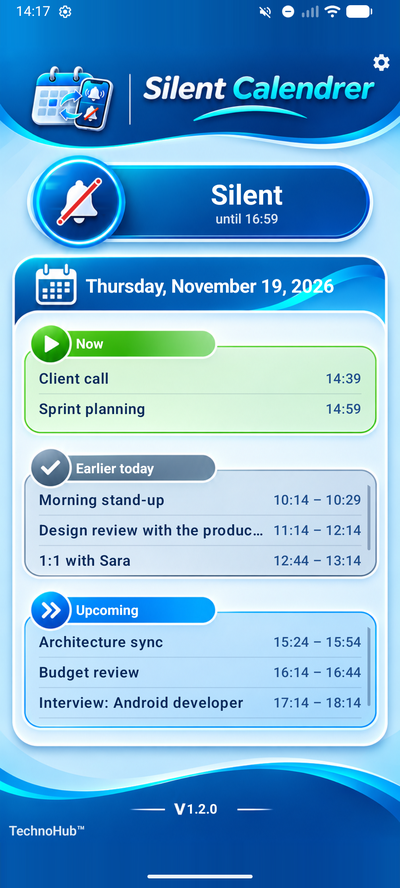
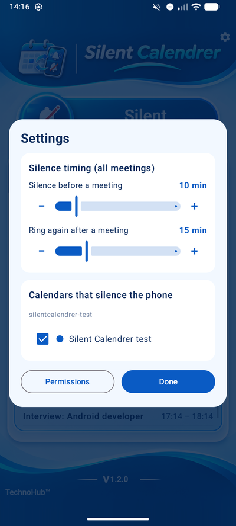
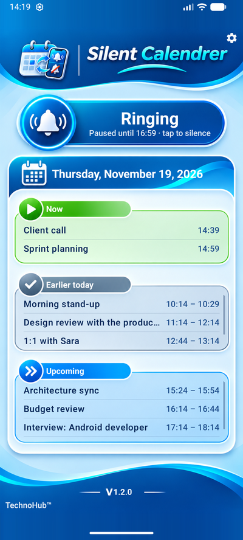

# Silent Calendrer

**Your phone goes silent before every meeting and rings again after it — automatically.**

Silent Calendrer reads the meetings in your phone's calendar (including Google Calendar) and
switches the ringer to **Silent** shortly before each one starts, then back to **Ringing** after it
ends. No account sign-in, no internet access, no data leaves your phone.

  
  &nbsp;
  
  &nbsp;
  

## Features

- **Automatic** — silent 10 minutes before a meeting, ringing 15 minutes after (both adjustable, 0–60 min).
- **Back-to-back meetings handled** — overlapping or close meetings are merged, so the phone never
  rings in between.
- **Smart filtering** — accepted and tentative meetings count; declined meetings, unanswered
  invitations, cancelled and all-day events are ignored.
- **Choose your calendars** — switch off calendars (e.g. family or holidays) that shouldn't silence the phone.
- **Let it ring** — need to be reachable during one meeting? One tap on the notification pauses
  silencing until that meeting is over.
- **Respects you** — if you turn the ringer back on during a meeting, the app waits 2 minutes before
  silencing again.
- **Today at a glance** — what's on now, what's done, and what's coming (including tomorrow's
  early meetings within the next 6 hours).
- **Reliable** — survives app closing, reboots and phone restarts; uses exact alarms for on-time switching.
- **Phone and tablet layouts**, portrait and landscape.

## Requirements

- Android **14 or newer**
- A calendar synced to the phone (Google Calendar, Outlook, Samsung/OPPO calendar, …)

## Install

1. Download `SilentCalendrer-<version>.apk` from the [latest release](../../releases/latest).
2. Open it on your phone and allow installing from that source if Android asks.
3. Open **Silent Calendrer** and follow the setup screen.

The app needs four permissions — it explains each one during setup:

| Permission | Why |
|---|---|
| Calendar | To read your meetings |
| Do Not Disturb access | Android only lets apps with this access switch the phone to Silent and back |
| Alarms & reminders | To switch at the exact minute |
| Notifications | To show "Silent until …" and the **Let it ring** button |

## Documentation

- 📱 **[User guide](docs/USER_GUIDE.md)** — setup, daily use, settings, troubleshooting
- 🛠 **[Developer guide](docs/DEVELOPER_GUIDE.md)** — architecture, building, testing, releasing
- 📝 **[Changelog](CHANGELOG.md)**

## Good to know

- On most phones Android turns on **Do Not Disturb** when an app sets Silent, and turns it off again
  when Ringing is restored. Calls from starred contacts and alarms still come through, according
  to your phone's Do Not Disturb settings.
- Some phone makers (OPPO, Xiaomi, Huawei, Samsung…) stop background apps to save battery. If a
  switch is ever late, allow Silent Calendrer to run without battery restrictions — see the
  [user guide](docs/USER_GUIDE.md#troubleshooting).

## License

The **source code** is released under the [MIT License](LICENSE).
The **artwork** (backgrounds, app icon, bell images) and the **TechnoHub™** name are
© TechnoHub, all rights reserved — see [ART-LICENSE.md](ART-LICENSE.md).

---

Made by **TechnoHub™**
