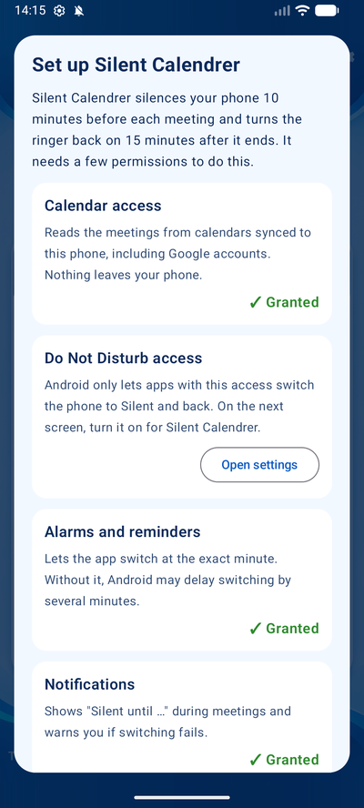
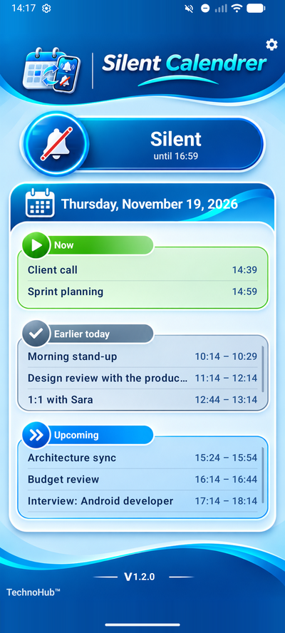
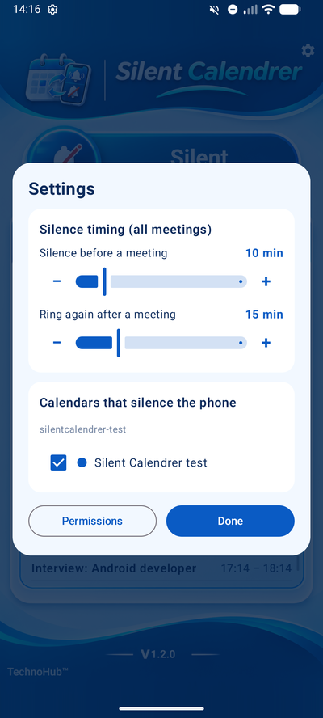
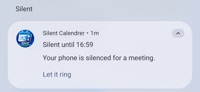
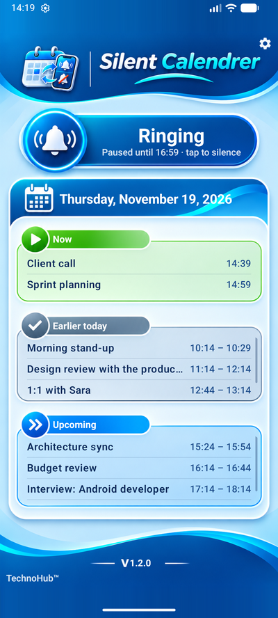

# Silent Calendrer — User guide

- [First-time setup](#first-time-setup)
- [The main screen](#the-main-screen)
- [How silencing works](#how-silencing-works)
- [Settings](#settings)
- [Let it ring](#let-it-ring)
- [Do Not Disturb, explained](#do-not-disturb-explained)
- [Troubleshooting](#troubleshooting)
- [Privacy](#privacy)

---

## First-time setup

When you open the app for the first time, a setup screen lists what it needs. Tap each button and
allow it; a green **✓ Granted** appears when done. You can skip steps and come back later — a red
banner at the bottom of the main screen reminds you of anything missing.



| Step | What to do | Needed? |
|---|---|---|
| **Calendar access** | Tap **Grant** → **Allow** | Required |
| **Do Not Disturb access** | Tap **Open settings** → find **Silent Calendrer** → switch it on → go back | Required |
| **Alarms and reminders** | Tap **Open settings** → allow | Strongly recommended (on-time switching) |
| **Notifications** | Tap **Grant** → **Allow** | Recommended (shows *Silent until…* and *Let it ring*) |
| **Battery** | Tap **Open settings** → set Silent Calendrer to *Unrestricted / Don't optimize* | Recommended on OPPO, Xiaomi, Huawei, Samsung |

Then tap **Continue**. That's it — the app works in the background from now on; you don't need to
keep it open.

## The main screen



| Part | Shows |
|---|---|
| **Bell and mode** | The phone's real ringer mode: **Ringing**, **Silent** (crossed-out bell) or **Vibration**. While the app keeps the phone silent, it also shows *until HH:MM*. |
| **Date** | Today |
| **Now** | Meetings happening right now, with their end time |
| **Earlier today** | Meetings that already ended today |
| **Upcoming** | The rest of today, plus tomorrow's meetings that start within the next 6 hours (shown with the weekday, e.g. *Fri 01:30*) |
| **⚙ (top right)** | Settings |
| **Footer** | App version |

Lists scroll when there are more meetings than fit.

## How silencing works

For every meeting, the phone is silent from **10 minutes before** it starts until **15 minutes after**
it ends (you can change both numbers in [Settings](#settings)).

```
Meeting 10:00 – 11:00   →   Silent 09:50   ·   Ringing 11:15
```

**Overlapping or close meetings** are combined, so the phone doesn't ring in between:

```
Meeting A 10:00 – 11:00
Meeting B 10:30 – 11:30   →   Silent 09:50   ·   Ringing 11:45   (no ringing at 11:15)
```

**Which meetings count**

| Counted | Ignored |
|---|---|
| Meetings you **accepted** | Meetings you **declined** |
| Meetings you answered **maybe** (tentative) | Invitations you **haven't answered** |
| Your own events without guests | **All-day** events (birthdays, holidays…) |
| Events marked *Free* | **Cancelled** events |
| | Events in calendars you switched off in Settings |

An event without an end time is treated as one hour long.

**If you change the ringer yourself during a meeting**, the app respects it for **2 minutes**, then
silences again if the meeting is still on. Changing it again restarts the 2 minutes. If you need
the phone to ring for the rest of the meeting, use [Let it ring](#let-it-ring) instead.

**After the meeting** the phone always goes back to **Ringing** — even if it was on Vibration before.

**Meeting moved or cancelled?** The app notices calendar changes within moments (as soon as your
calendar has synced) and adjusts: a cancelled meeting ends the silence immediately.

## Settings

Tap **⚙** at the top right of the main screen.



- **Silence before a meeting** — 0 to 60 minutes (default 10).
- **Ring again after a meeting** — 0 to 60 minutes (default 15).
  Drag the slider, or use **−** / **+** for single minutes. **Reset to 10 / 15** restores the defaults.
  Changes apply immediately — even to a meeting that is in progress.
- **Calendars that silence the phone** — untick a calendar to ignore its events (for example a
  family calendar or a shared team calendar). New calendars are included automatically.
- **Permissions** — reopens the setup screen.

The timing is one setting for all meetings.

## Let it ring

Sometimes you must be reachable during a meeting. While the phone is silenced, the notification
**Silent until HH:MM** has a **Let it ring** button:



Tap it and the phone rings again **until the current meeting (window) ends**. The app shows
*Paused until HH:MM · tap to silence*:



- Changed your mind? Tap the mode bar in the app to **silence again**.
- The next meeting is silenced normally.

## Do Not Disturb, explained

On most Android phones, setting **Silent** also turns on **Do Not Disturb** (you'll see the DND
icon). This is how Android implements Silent — the app only asks for Silent. When the app restores
Ringing after the meeting, Do Not Disturb turns off again.

During Do Not Disturb your notifications still **arrive** — silently, in the notification shade.
What can still get through (for example calls from starred contacts, repeat callers, alarms)
depends on your phone's **Do Not Disturb settings**, which you can change in Android Settings.

## Troubleshooting

**A switch happened late, or not at all**
1. Open the app — a red banner at the bottom shows anything that is missing. Tap it to fix.
2. Make sure **Alarms & reminders** is allowed (Settings → Apps → Silent Calendrer).
3. Allow the app to run in the background without battery restrictions (menu names vary by phone and version):
   **OPPO / realme / OnePlus (ColorOS):** Settings → Battery → (App battery management) →
   Silent Calendrer → **Allow background activity** / *Don't optimize*.
   **Xiaomi:** Settings → Apps → Silent Calendrer → Battery saver → **No restrictions**, and enable *Autostart*.
   **Samsung:** Settings → Battery → Background usage limits → make sure Silent Calendrer is not in
   *Sleeping* / *Deep sleeping apps*.
4. Don't use **Force stop** on the app — Android then cancels all of its alarms until you open it again.
   (Swiping it away from recent apps is fine.)

**A meeting is missing from the list**
- Check that its calendar is synced and visible in your calendar app.
- Check it isn't unticked in Silent Calendrer → ⚙ → Calendars.
- Declined, unanswered, cancelled and all-day events are ignored on purpose.
- A meeting created on another device appears after your phone's calendar has synced.

**The app says Silent but the phone rang / the screen shows the wrong mode**
The app reads the *real* state of the ring sound. If you see a mismatch, note the time and your
phone model and report it — some phone makers handle Silent differently.

**"The phone did not switch to Silent when asked"**
Your phone refused the switch (some models only allow Vibration). The app reports it instead of
retrying every two minutes.

**I want the phone to ring during one meeting** → use [Let it ring](#let-it-ring).

## Privacy

- Meetings are read from your phone's own calendar storage. The app has **no internet access**.
- Nothing is uploaded, shared or tracked.
- The app only stores times (not meeting titles) for its schedule, so it can recover after a restart.
